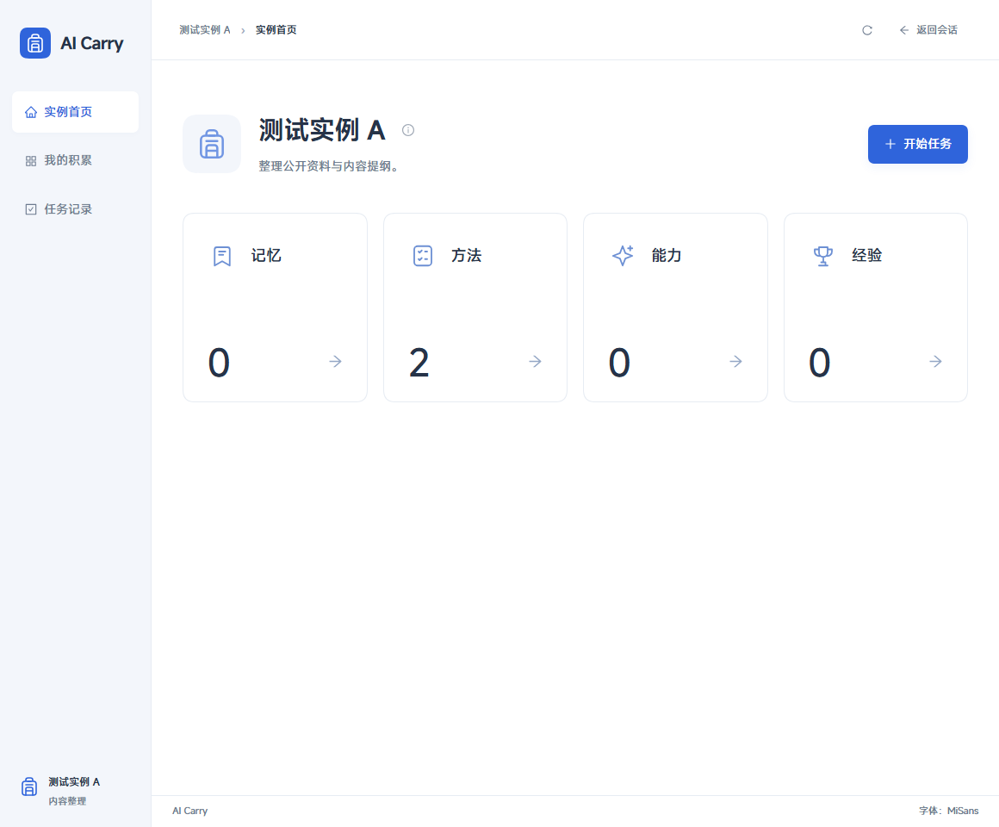

# AI carry-DSH

AI Carry 的 DeepSeek Harness 原生插件，作为独立项目维护。原项目为 [AI-Carry](https://github.com/Ww-Cooooo/AI-Carry)；本仓库只提供 Harness 插件、必要的公共核心模块和合成测试模板。

从 Harness 的工作区菜单直接打开对应 AI Carry 实例，首页只显示实例名称、简短用途，以及记忆、方法、能力、经验四个分类的数量。点击分类看标题，再点条目查看正文与来源。把方法与本次要求送入这个工作区的会话；成果产生后，编辑有来源的学习建议，再决定是否留下。正式内容继续保存在实例的 Markdown/TOML 文件中。

依据：0.1.0 在真实 Harness 会话中完成材料投递、模型成果、学习草稿、编辑保存及正文回读；普通检索已找回保存内容。测试使用无私密资料的正式结构实例。

## 安装与开始

本版本面向**已有 AI Carry 2.2.0 实例**的用户，验证环境为 **Windows、DeepSeek Harness 0.2.2-rc.1**。需要 Harness 已配置可用模型，以及其官方 `dsh` 命令；普通 CLI 还需 PATH 中有 `pnpm`，桌面版随附命令使用自带的包管理器。从 [v0.3.0 Release](https://github.com/Ww-Cooooo/AI-carry-DSH/releases/tag/v0.3.0) 下载 `eh3-dsh-ai-carry-0.3.0.tgz`，无需编译源码；同页提供 `SHA256SUMS.txt`。本插件不创建实例；没有实例时，先在 AI Carry 2.2.0 自身的首次建立流程中完成实例建立。测试 fixture 不是你的个人实例。

**平时直接打开 Harness 桌面应用**：它使用 `desktop` profile（配置环境）。在 PowerShell 7 中，把下面示例路径换成你实际安装目录中的 `resources/runtime/cli/bin/dsh.cmd`，在安装包所在目录执行：

```powershell
$dsh = 'D:/Apps/DeepSeek Harness/resources/runtime/cli/bin/dsh.cmd'
& $dsh plugin --profile desktop add ./eh3-dsh-ai-carry-0.3.0.tgz --ignore-scripts
```

安装后完全退出并重新打开 Harness 桌面应用，继续使用原来的模型配置。这里必须使用桌面版随附命令；普通 CLI 不管理保留的 `desktop` 环境，也不能用 `dsh --profile desktop` 启动桌面应用。此安装入口依据官方桌面 CLI；验证记录分别说明桌面安装与独立 Web profile 的界面检查范围。

**通过命令启动 Harness Web，或已有自定义 profile**：把下面的 `my-profile` 换成平时启动命令中的名字。使用 `dsh web` 的用户就填 `web`；CLI 没有可省略名称的默认 profile。

```powershell
dsh plugin --profile my-profile add ./eh3-dsh-ai-carry-0.3.0.tgz --ignore-scripts
dsh --profile my-profile
```

需要另建独立测试环境时，**仅首次创建未使用过的名称**：

```powershell
dsh --profile ai-carry --from-default-profile web --dump-config > $null
dsh plugin --profile ai-carry add ./eh3-dsh-ai-carry-0.3.0.tgz --ignore-scripts
dsh --profile ai-carry
```

初始化命令会重置同名 profile，因此不要对已有环境重复运行。若 `dsh` 不在 PATH，请使用当前 Harness 安装提供的 `dsh.cmd` 完整路径替代命令名；不需要另装或升级 Harness。

新 profile 会读取同一 `DSH_HOME` 中由 Harness 管理的现有账号凭据；插件不会复制它们。仅写在其他 profile 自身 patch 中的模型设置不会因此复制。启动后以目标会话的模型选择器为准。

若新 profile 没有列出你原来可用的模型，采用上面对应的桌面或已有 Web profile 安装路径，在原来已配置好的环境中使用插件；不必为本插件重新提供密钥。

启动后，在 Harness 添加或打开已有实例的**根目录工作区**。这一层包含 `assistant.toml`、`core/manifest.toml` 和 `instance/manifest.toml`，例如 `D:/AI-Carry/my-instance`；不要填它下面的 `instance` 子目录。模板和开发母版不能作为实例。

1. 右击这个工作区，选择 **打开 AI Carry**，直接进入该实例首页。首页看实例身份和四类积累数量；点击分类、条目逐层查看。名称旁的信息按钮可查看完整用途与工作目录。
2. 点击“开始任务”，选择这个工作区的会话，或在这里新建会话，写明这次要完成的任务。
3. 查找方法，展开候选，调整“仅用于这次的要求”，点击“将材料送入目标会话”。材料只能进入该实例根目录下的会话。
4. 打开目标会话查看模型运行；回到插件点击“读取成果”，核对实际材料记录与成果。
5. 点击“请会话提出学习建议”，或根据成果自己写一条建议。在“处理学习”中编辑并查看正式保存预览，再选择“留下”“仅这次”“先观察”“以后提醒”或“不保存”。

侧栏 **AI Carry** 会跟随当前会话的实际工作区。没有明确工作区时，才显示已连接实例清单；明确目录不是实例时，显示该目录的检查与打开指引，不切换到其他实例。未提交的任务标题按实例与工作区保留在当前浏览器标签页；方法要求和学习编辑按任务分别保留。关闭标签页会结束这部分临时草稿，已经保存的任务与学习记录不受影响。

## 使用与学习分别核对

本次要求不改写长期偏好。材料有稳定请求编号，投递回执不明时点击界面出现的“重试原材料投递”，保留当前方法和要求，即会沿用原请求编号；不要为此创建另一个任务。成果只取当前任务对应材料之后、下一个实际用户请求之前的可读回答。

依据：实际材料记录、真实模型成果及“回执丢失后重试”的集成检查；检索最多返回三个候选，正文只按本次选择读取。

学习建议保留成果引用。修改草稿后，原预览不能用于保存；“留下”使用实例原有事务、去重和写入协调。界面分别显示正式保存、正文回读、普通检索和后续实际效果，不能把保存成功理解为模型已经学会。

依据：编辑后的正式文件与预览逐字一致；实际检索找回；外部文件冲突、同时写入、进程中断和部分失败均有针对性检查。

“先观察”和“以后提醒”会在实例的 `instance/evolution/` 中持久保存候选及相应索引；提醒还记录指定的复核时间。回执会显示候选文件的相对位置。后续将该位置交给你原来的 AI Carry 助手，点名这一条候选进行复核；具体规则在该实例的 `instance/evolution/README.md`。首版插件不提供完整候选管理页。提醒记录不是操作系统通知，也不保证到时自动弹窗。

这两类候选不会进入插件的普通方法检索，也不会作为已接受规则送进会话。回执仍在原任务的“处理学习”中，之后可从“已记录任务”重新打开查看。

“仅这次”会在当前任务中登记本次处理选择，不会把编辑后的建议再次送入会话、改写已有成果或提升为长期规则；“不保存”表示拒绝将这条建议写入实例。两者都不写长期资产、不撤销已经产生的成果。**草稿正文、成果引用和处理选择仍保留在插件任务记录中**；“不保存”不是清除这些记录。

## 数据、模型与恢复

- **实例文件**：留在所连接目录，Markdown/TOML 为唯一正式真源。插件不自动迁移或升级实例。
- **任务记录**：默认位于当前系统用户目录下的 `.ai-carry/harness-control`，保存绑定、材料版本、成果引用、学习草稿和事务回执。未提交的编辑会临时保留在当前浏览器会话中；点击保存草稿/预览后才进入 Host 记录。
- **会话与模型**：由 Harness 管理。点击投递或请求建议，会把选定的方法、任务要求或所选成果送往该会话配置的模型，适用该模型的费用与数据规则。插件不复制登录凭据、不自行扫描全部聊天。
- **写入权限**：模型工具可以提出草稿和预览；正式处理选择仅接受 Harness 当前所有者的界面操作。插件不会代替人批准自己生成的建议。
- **中断恢复**：若显示“保存中断”，点击“恢复并核对原保存”。已提交正文只核对和刷新派生展示；未完成且可判定的事务按原记录恢复或回滚。外部变化不被强行覆盖，失败不会删除已有成果。
- **解除连接与卸载**：保留实例文件和任务记录。解除连接后，原任务仍可查看；重新连接同一实例后继续操作。备份时同时保留实例目录与任务记录目录。

多个 Harness 同时运行时，每个插件环境应配置自己的任务记录目录；同一目录已有活动 Host 会拒绝另一写入者。实例层仍使用 AI Carry 原有写锁协调。在 `$DSH_HOME/profiles/<profile名>/cordis.patch.yml` 中添加下面这一项；未设置 `DSH_HOME` 时，它位于系统用户目录下的 `.dsh`。例如桌面环境对应 `.dsh/profiles/desktop/cordis.patch.yml`。

```yaml
- id: eh3-ai-carry
  config:
    stateDirectory: D:/AI-Carry/harness-records
```

保留文件中的其他配置项；已有同一 `id` 时修改那一项，不要重复添加。Harness 的 patch 会替换该项的整份 `config`，不是逐字段合并。机器级 `$DSH_HOME/cordis.patch.yml` 和启动时的 `--patch` 优先级更高；如它们也设置了这一项，请保持一致。更改后重启对应环境。

禁用可在 Harness 插件管理中操作。卸载当前 profile 的包：

```powershell
dsh plugin --profile my-profile remove eh3-dsh-ai-carry
```

桌面用户用同一个 `$dsh` 执行 `& $dsh plugin --profile desktop remove eh3-dsh-ai-carry`，然后重开桌面应用；Web 用户重启对应 profile。上述命令不会删除实例或任务记录。首次安装、更新和卸载均只针对你指定的 profile。

## 验证范围

0.3.0 已在安装的 Harness Web Client 验证工作区菜单、对应实例首页、实例切换、任务与学习草稿保留、同工作区新建会话、错误目录指引及当前会话入口；完成 1440×960 和 1100×800 布局检查与 MiSans 实际字形检查。材料、真实模型成果和正式保存的验证由 0.1.0 完成，本版重新显示并核对这些成果与回执。[验证记录](VALIDATION.md) 说明测试范围和已知限制。

真实模型验证使用本机已有 DeepSeek Account 配置，没有重新配置或复制密钥。测试实例内容是合成资料；这不代表你的生产实例已经验收。桌面应用外壳的独立焦点/输入体验、其他操作系统、其他 Harness 版本和长期学习效果尚未验证。

当前界面为中文。关系图仅表示已有引用；图示加载失败时仍能查看对应文字。完整中文字库已内嵌，正常使用不依赖外部字体或图表 CDN。

依据：原生入口截图、浏览器运行记录、真实会话与正式文件核对。界面视觉偏好和动态手感尚未得到用户签收。

以下来自合成测试实例中的已安装 0.3.0 插件，仅展示插件区域：



[查看正式保存、正文回读和普通检索的分项回执](docs/screenshots/native-saved-receipt.png)。

## 源码开发

下载或克隆本仓库，在仓库根目录使用 Node 24.9+：

```powershell
npm ci --legacy-peer-deps --ignore-scripts
npm run build
npx --no-install tsc -p tsconfig.client.json
node scripts/init-fixtures.mjs
npm test
npm pack
```

初始化脚本只在仓库的 `fixtures/runtime-data/` 内按正式规则建立合成实例；不会连接个人实例。构建使用官方 Typert 生成器，所需公共模块、空白模板和本地字体已包含，不依赖旁边另有一份 AI Carry 开发仓库。`npm pack` 在当前目录生成可安装 `.tgz`。测试脚本和 fixture 不进入安装包。普通用户优先使用 Release 安装包；没有验证直接从 GitHub 依赖安装的路径。

依赖扫描对 Harness 同版的 Zod 4.4.3 报告上游大集合校验内存消耗告警（GHSA-mrhx-c7xc-m3w5，三条关联包记录）。本插件的学习草稿限制为 16,000 字符并要求所有者身份；未自动升级宿主共享依赖。请勿把这一局部限制理解为宿主整体风险已消除。

## 许可

本插件及复用的 AI Carry 公共核心模块采用 [Apache-2.0](LICENSE)。上游来源、原始文件哈希和改动标记记录在包内 `vendor/ai-carry/PROVENANCE.json`，适配说明见 [NOTICE](NOTICE)；未包含个人资产或私有原型。第三方 UI 依赖与字体遵循各自条款，见 [第三方声明](THIRD_PARTY_LICENSES.md)。GSAP 使用 Standard No Charge License；MiSans 使用小米 MiSans 字体许可，完整许可随包附带于 `licenses/MiSans-License.pdf`，不纳入 Apache-2.0。
